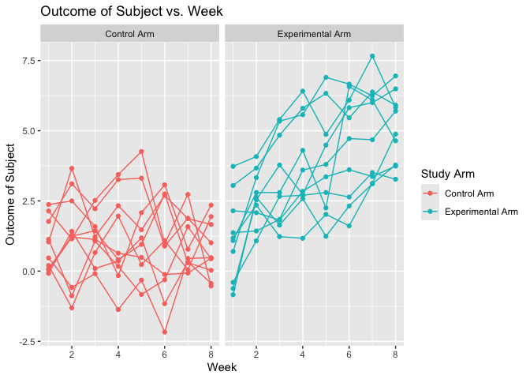
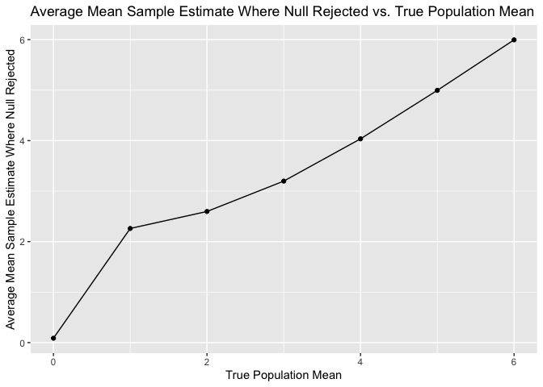

Homework 5
================
Yuyi Lin
2026-11-18

``` r
library(tidyverse)
```

# Problem 1

``` r
set.seed(1236)
birthday_repeated = function(n_room) {
  birthdays = sample(1:365, size = n_room, replace = TRUE)
  repeated_birthdays  = length(unique(birthdays)) < n_room
  return(repeated_birthdays)
}

birthday_repeated(147)
```

    ## [1] TRUE

TRUE statement confirms that there are duplicate birthdays in the group.

``` r
birthday_results_df =
  expand_grid(
    number_of_people = 2:50,
    iter = 1:10000
  ) |> 
  mutate(
    repeated = map_lgl(number_of_people, birthday_repeated))
    
birthday_results_df |> 
  group_by(number_of_people) |> 
  summarize(prob_of_repeat = mean(repeated)) |> 
  ggplot(aes(x = number_of_people, y = prob_of_repeat)) + 
  geom_point() + 
  geom_line() +
  labs(
    title = "Probability of Sharing Birthdays vs. Number of People in Room",
    x = "Number of People in Room",
    y = "Probability of Sharing Birthdays"
  )
```

<!-- -->

Plot confirms that the probability of least two people in a group/room
sharing a birthday increases when there is more people in the room. When
this probability is 50%, there are about 22-23 people in the room.

# Problem 2

``` r
study_df = 
  tibble(
    files = list.files("./data"), 
    path = str_c("./data/", files)
  ) |>
  mutate(data = purrr::map(path, read_csv, show_col_types= FALSE)) |> 
  unnest(data)
```

### Tidy Dataframe

``` r
tidy_df = 
  study_df |> 
  mutate(
    files = str_replace(files, ".csv", ""),
    group = str_sub(files, 1, 3),
    group = case_match(
      group,
      "con" ~ "Control Arm",
      "exp" ~ "Experimental Arm"),
    subject_id = str_sub(files, 5, 6)) |> 
  pivot_longer(
    week_1:week_8,
    names_to = "week", 
    names_prefix = "week_", 
    values_to = "outcome") |>
  mutate(week = as.numeric(week)) |> 
    select(group, subject_id, subj = files, week, outcome)
```

    ## Warning: There was 1 warning in `mutate()`.
    ## ℹ In argument: `group = case_match(group, "con" ~ "Control Arm", "exp" ~
    ##   "Experimental Arm")`.
    ## Caused by warning:
    ## ! `case_match()` was deprecated in dplyr 1.2.0.
    ## ℹ Please use `recode_values()` instead.

``` r
tidy_df |> 
  ggplot(aes(x = week, y = outcome, group = subj, color = group)) + 
  geom_line() + 
  geom_point() + 
  facet_grid(~group) + 
  labs(
    title = "Outcome of Subject vs. Week",
    x = "Week",
    y = "Outcome of Subject",
    color = "Study Arm"
  )
```

<!-- -->

Plot indicates while participants in the control arm seemed to have
similar outcomes over the week (ranging from about -1.2 to 3.7),
participants in the experimental arm had increased outcomes, scaling up
from 0 to 7.5 over the week.

# Problem 3

``` r
sim_ttest = function(mu){
  sim_data = 
    tibble(
      x = rnorm(30, mean = mu, sd = 5)
    )
  t.test(pull(sim_data, x), mu = 0) |> 
    broom::tidy() |> 
    select(estimate, p.value)}

set.seed(1236)

sim_results_df = 
  expand_grid(
    mu = 0:6,
    iter = 1:5000) |> 
  mutate(
    est_df = map(mu, sim_ttest)) |> 
  unnest(est_df) |> 
  mutate(rejected = p.value < 0.05)

sim_results_df
```

    ## # A tibble: 35,000 × 5
    ##       mu  iter estimate p.value rejected
    ##    <int> <int>    <dbl>   <dbl> <lgl>   
    ##  1     0     1    0.758  0.346  FALSE   
    ##  2     0     2    1.05   0.154  FALSE   
    ##  3     0     3    0.909  0.266  FALSE   
    ##  4     0     4    0.176  0.829  FALSE   
    ##  5     0     5   -1.84   0.0887 FALSE   
    ##  6     0     6   -0.186  0.817  FALSE   
    ##  7     0     7   -0.195  0.847  FALSE   
    ##  8     0     8    0.886  0.287  FALSE   
    ##  9     0     9    1.21   0.193  FALSE   
    ## 10     0    10    0.414  0.694  FALSE   
    ## # ℹ 34,990 more rows

``` r
sim_results_df |> 
  group_by(mu) |> 
  summarize(power = mean(rejected)) |> 
  ggplot(aes(x = mu, y = power)) + 
  geom_point() + 
  geom_line() +
  labs(
    title = "Power vs. True Population Mean",
    x = "True Population Mean",
    y = "Probability of Rejecting False Null Hypothesis (Power)"
  )
```

<!-- -->

As the true population mean moves further away from the null, effect
size increases, and power increases in a sigmoidal manner. This plot
supports that power increases with effect size, meaning that studies
with small true effect sizes may be underpowered compared to studies
with larger true effect sizes.

``` r
sim_results_df |> 
  group_by(mu) |> 
  summarize(emp_mean = mean(estimate)) |> 
  ggplot(aes(x = mu, y = emp_mean)) + 
  geom_point() + 
  geom_line() +
  labs(
    title = "Average Mean Sample Estimate vs. True Population Mean",
    x = "True Population Mean",
    y = "Average Mean Sample Estimate"
  )
```

<!-- -->

The relationship between average mean sample estimate and the true
population mean follows a linear positive relationship where slope = 1.
For every point on the graph, x=y across all values (Ex. (0,0), (1,1),
(2,2), (3,3)…). This indicates that the sample mean is an unbiased
estimator of the true population mean across multiple iterations.

``` r
sim_results_df |> 
  filter(rejected == TRUE) |> 
  group_by(mu) |> 
  summarize(
    emp_mean = mean(estimate)) |> 
  ggplot(aes(x = mu, y = emp_mean)) + 
  geom_point() + 
  geom_line() + 
  labs(
    title = "Average Mean Sample Estimate Where Null Rejected vs. True Population Mean",
    x = "True Population Mean",
    y = "Average Mean Sample Estimate Where Null Rejected"
  )
```

<!-- -->

After filtering by samples for which the null was rejected, we found
that the average mean estimate overestimated the true population mean at
smaller effect sizes (x = 1, 2, and 3). This shows how lower power may
lead to less accurate estimates when detecting true effect sizes. At
higher effect sizes, average sample estimate was more indicative of the
true population mean due to higher power.
